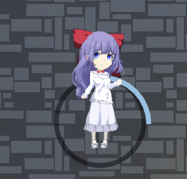

# Restless

[English](README.md) · [中文](README.zh-CN.md) · for KinkiestDungeon **5.5.6+**

> I know this doc has a really strong, weird AI-generated feel, and I hate it. But I spent the entire day editing it and then it got ruined!!!! Okay, I give up—please just let me set it aside for now.

**The dungeon doesn't wait for you to think.** After a few seconds without acting, your character waits one turn in place. The lower your stamina, the faster the clock runs — hesitate too long and the world moves on without you.

It never moves you, attacks, or uses items: it only waits. Take any turn yourself and the timer starts over. Everything is tuned outside the run, in `Options → Mod Configuration → Restless`.

  
  

## What you'll see

- A thin arc under your feet fills up while the timer runs. When it fills, one turn passes and the arc starts over. Other styles: a bar under your feet, a bar above your head, or nothing at all.
- Its colour follows your stamina stage — cold blue, green, amber, orange, red — so you can feel the pace without reading numbers.
- It disappears whenever the game is paused: menus, dialogs, containers, animations, sleep, frozen.
- Standing on a staircase or on an interactable object pauses the timer, so you don't auto-descend or poke things by accident.

**Quiet mode** (off by default) keeps the screen completely empty and fades the indicator in only for the last 3–5 seconds, or once stamina drops below 25%.

## Bullet time

Map inspection and spell casting aiming are slowed: Inspection ×6, Aiming ×3, adjustable from 0 to 12. Set either to 0 to revert to the old version's "complete pause".

The progress you've already built up carries over when you enter or leave these modes, so ducking into inspect mode at the last moment doesn't buy you a free breath.

## The pace

The waiting interval comes from your stamina ratio `r` (current / max), mapped three ways:

| Mode | Shape | Feels like |
| --- | --- | --- |
| **Linear** | shrinks smoothly with stamina | a gentle, predictable slide |
| **Staged** | fixed inside each tier, then jumps at the thresholds | distinct gear changes |
| **Combined** (default) | the two multiplied — smooth, plus a step at each threshold | the most dramatic |

Stage thresholds and their factors:

| Stamina | ≥95% | ≥75% | ≥50% | ≥25% | <25% |
| --- | --- | --- | --- | --- | --- |
| Stage | Calm | Steady | Tense | Urgent | Critical |
| Factor | 1.20 | 1.00 | 0.85 | 0.70 | 0.55 |

At the defaults that works out to roughly **4.8 s per turn at full stamina** and **1.5 s when exhausted**. Waiting restores stamina at double rate, so burning out pushes you through a few quick turns and then the pace eases off again on its own.

## Settings

`Options → Mod Configuration → Restless` — outside the run, there's no in-game menu.

| Setting | Default | Notes |
| --- | --- | --- |
| Enable auto-advance | on | master switch |
| On-screen indicator | Ring (under feet) | ring / bar under feet / bar above head / off |
| Quiet mode (only near the moment) | Off (always show) | only in the last 3 s / last 5 s / below 25% stamina / either |
| Stamina curve mode | Combined | linear / staged / combined |
| Base interval (ms) | 4000 | the pace before any curve modifier |
| Linear strength (0-1) | 0.55 | how hard the linear curve bends (0 = off) |
| Stage strength (0-1) | 1.0 | how hard the staged curve bends (0 = off) |
| Min / Max interval (ms) | 1500 / 9000 | floor and ceiling for the interval |
| Inspect slowdown (0 = pause) | 6 | 0 = old hard pause, 1 = normal speed |
| Aim slowdown (0 = pause) | 3 | same, for spells and item aiming |
| Pacing direction | Faster when tired | or Slower when tired |
| Interval jitter (0-0.3) | 0.1 | random wobble, so it never feels metronomic |
| Stage change notice | on | a one-line message when the pace changes gear |

There's a debug panel and a console log too, if you like watching the numbers.

## Install

1. Download from Discord / [Releases](../../releases).
2. Standalone build: drop the zip into `<game>/Mods/` and restart the game. Web build: turn on **Auto Load Mods**, then `Options → Mods → Load Mod .zip`, then reload the page.
3. `Options → Mod Configuration → Restless`.

The game runs mods once per page load, so reloading after adding the zip is normal. If `Mod Configuration` has no Restless tab at all, the mod didn't run.
