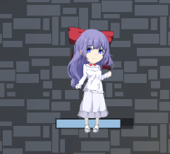
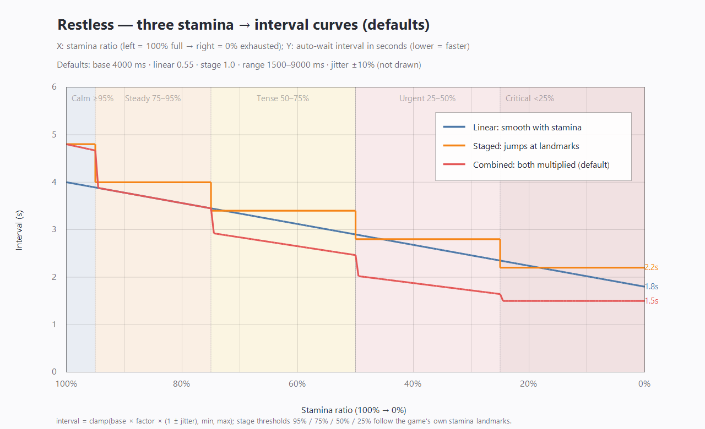
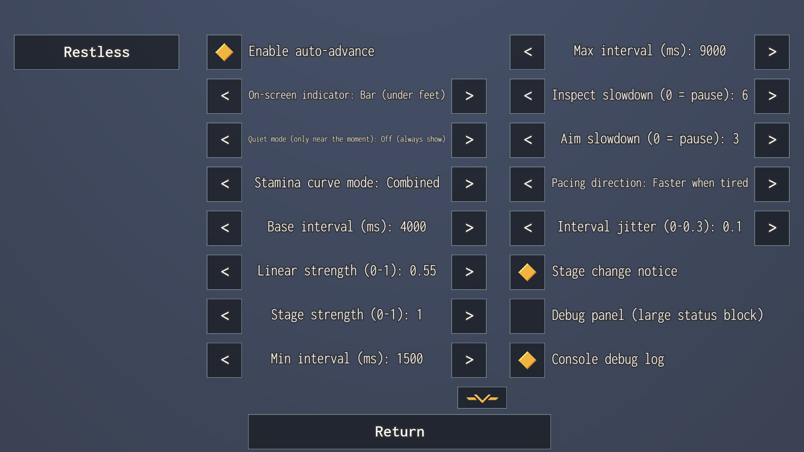

# Restless

[English](README.md) · [中文](README.zh-CN.md) · For KinkiestDungeon **5.5.6+**

**The dungeon won't wait for you to finish thinking.** Idle for a while and your character takes a turn on the spot. The lower your stamina, the less time you get to react.

  
  

- The timer stops while a menu, dialogue, inventory or animation is open, and while you sleep or are frozen.
- Standing on a staircase tile or on an interactable object pauses it automatically.

**Quiet mode** (off by default — though we do recommend turning it on, haha) only shows up in the last 3–5 seconds, or once stamina drops below 25%.

Inspecting the map and aiming spells slip into "bullet time" (without resetting the timer — no freeloading, haha): the interval stretches to 6× while inspecting and 3× while aiming. Set either to 0 and the clock pauses outright.

What follows is AI-generated documentation. We wouldn't recommend reading it by hand...

---

## Pace

The interval comes from the stamina ratio `r` (current / max) through one of three algorithms:

| Mode | Shape | Feel |
| --- | --- | --- |
| **Linear** | Shortens smoothly with stamina | A natural, predictable gradient |
| **Staged** | Fixed per bracket, jumps only when crossing one | A clear "next stage" |
| **Combined** (default) | The two multiplied — smooth, plus one step per bracket | The most dramatic |

Bracket thresholds and their multipliers:

| Stamina | ≥95% | ≥75% | ≥50% | ≥25% | <25% |
| --- | --- | --- | --- | --- | --- |
| Stage | Calm | Steady | Tense | Urgent | Critical |
| Multiplier | 1.20 | 1.00 | 0.85 | 0.70 | 0.55 |

With the default values that works out to about **one turn every 4.8 s at full stamina, and every 1.5 s when exhausted**.

## Configuration

| Option | Default | Notes |
| --- | --- | --- |
| Enable auto-advance | On | Master switch |
| On-screen indicator | Ring (under feet) | Ring (under feet) / Bar (under feet) / Bar (above head) / Off |
| Quiet mode (only near the moment) | Off (always show) | Only in the last 3 s / Only in the last 5 s / Only below 25% stamina / Low stamina or last 3 s |
| Stamina curve mode | Combined | Linear / Staged / Combined |
| Base interval (ms) | 4000 | The baseline pace before the curve is applied |
| Linear strength (0-1) | 0.55 | How far the linear curve bends; 0 = no effect |
| Stage strength (0-1) | 1.0 | How far the staged curve bends; 0 = no effect |
| Min interval / Max interval (ms) | 1500 / 9000 | Lower and upper bounds for the interval |
| Inspect slowdown (0 = pause) | 6 | 0 restores a full pause, 1 = normal speed |
| Aim slowdown (0 = pause) | 3 | Same, for spell and item aiming |
| Pacing direction | Faster when tired | Can be flipped to "Slower when tired" |
| Interval jitter (0-0.3) | 0.1 | A random shake on every countdown, so it doesn't tick like a metronome |
| Stage change notice | On | Drops a line in the action feed when you cross a bracket |

There's also a debug panel and a console log. The log is on by default; turn it off in the options if it gets noisy.
