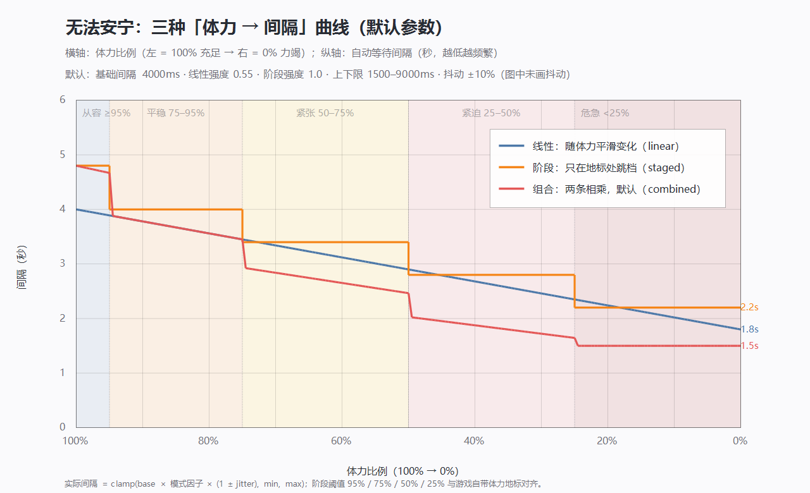
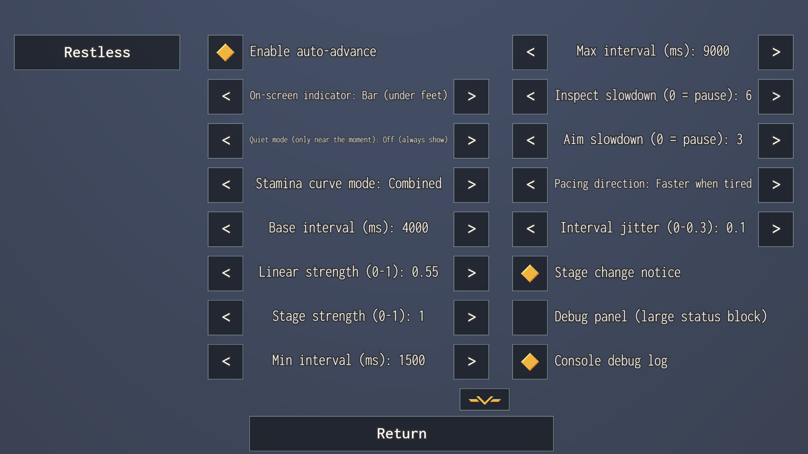

# 无法安宁 Restless

[English](README.md) · [中文](README.zh-CN.md) · 适用于 KinkiestDungeon **5.5.6+**

> 我知道这文档有非常浓重的诡异Ai味, 我很讨厌这个. 但是我改了一整天最后被毁掉了!!!! 好吧, 我妥协了, 请允许我暂时放弃.

**地牢不会等你慢慢想。** 一阵子没行动，角色就会自动在原地过一回合。体力越低，时间跑得越快 —— 犹豫太久，世界就先走一步。

它只会等：不会替你移动、攻击或使用物品。你随便做点什么（消耗一个回合），计时就重新开始。所有数值都在局外调：`Options → Mod Configuration → 无法安宁`。

  
  

## 会看到什么

- 脚下一圈很细的弧，计时在跑它就慢慢填满；填满那一刻过掉一回合，然后从零再来。也可以换成脚下横条、头顶横条，或者干脆不画。
- 颜色跟着体力档位走：冷蓝 → 绿 → 琥珀 → 橙 → 红，不看数字也能感觉到「时间在变急」。
- 打开菜单、对话、背包、动画，或者睡觉、被冻住时，指示器会消失，计时也跟着停。
- 站在楼梯格或可交互物上会自动暂停，免得替你自动下楼或者手贱去碰东西。

**安静模式**（默认关）开了以后平时画面里什么都没有，只在最后 3~5 秒、或者体力掉到 25% 以下时才淡入。

## 子弹时间

地图检视和施法瞄准放慢：检视 ×6、瞄准 ×3，0~12 可调。任意一项设成 0 就恢复旧版的「完全暂停」。

进出这两个状态时会保留这一拍已经走过的进度，所以卡着点切进检视不会白赚一次喘息。

## 节奏

间隔由体力比例 `r`（当前 / 上限）换算，三种算法：

| 模式 | 形状 | 手感 |
| --- | --- | --- |
| **线性** | 随体力平滑缩短 | 自然、可预期的渐变 |
| **阶段** | 每档固定，跨档才跳一次 | 明确的「进入下一阶段」 |
| **组合**（默认） | 两者相乘 —— 平滑，外加每档一个台阶 | 最戏剧化 |

档位门槛与对应系数：

| 体力 | ≥95% | ≥75% | ≥50% | ≥25% | <25% |
| --- | --- | --- | --- | --- | --- |
| 阶段 | 从容 | 平稳 | 紧张 | 紧迫 | 危急 |
| 系数 | 1.20 | 1.00 | 0.85 | 0.70 | 0.55 |

默认参数下大约是**满体力 4.8 秒一回合、力竭时 1.5 秒一回合**。

## 配置

`Options → Mod Configuration → 无法安宁`，只在局外调，游戏里没有入口。

| 选项 | 默认 | 说明 |
| --- | --- | --- |
| 启用自动推进回合 | 开 | 总开关 |
| 屏幕指示器 | 环形（脚下） | 环形（脚下）/ 进度条（脚下）/ 进度条（头顶）/ 关闭 |
| 安静模式（只在临近时显示） | 关闭（始终显示） | 最后 3 秒 / 最后 5 秒 / 体力低于 25% / 任一触发 |
| 体力曲线模式 | 组合 | 线性 / 阶段 / 组合 |
| 基础间隔（毫秒） | 4000 | 未经曲线修正时的基准节奏 |
| 线性强度（0-1） | 0.55 | 线性曲线的弯折程度，0 = 不生效 |
| 阶段强度（0-1） | 1.0 | 阶段曲线的弯折程度，0 = 不生效 |
| 最小间隔 / 最大间隔（毫秒） | 1500 / 9000 | 间隔的下限与上限 |
| 检视模式放慢倍数（0=暂停） | 6 | 0 = 回到完全暂停，1 = 正常速度 |
| 施法瞄准放慢倍数（0=暂停） | 3 | 同上，作用于法术与物品瞄准 |
| 节奏方向 | 低体力更快 | 也可以反转成「低体力更慢」 |
| 间隔随机浮动（0-0.3） | 0.1 | 每次计时的随机抖动，免得像节拍器 |
| 节奏变化提示 | 开 | 跨档时在行动提示区提一句 |

另外还有调试面板和控制台日志。控制台日志默认是开的（排查问题时挺顺手），嫌吵就在配置里关掉。

## 安装

1. 从 Discord / [Releases](../../releases) 下载。
2. 独立版：丢进 `<游戏目录>/Mods/`，重启游戏。网页版：先勾上 **Auto Load Mods**，再 `Options → Mods → Load Mod .zip`，然后刷新页面。
3. `Options → Mod Configuration → 无法安宁`。

游戏每次页面加载只执行一次 Mod，所以加完 zip 刷新一下是正常流程。如果 `Mod Configuration` 里压根没有 Restless 这一页，那就是没执行起来。
